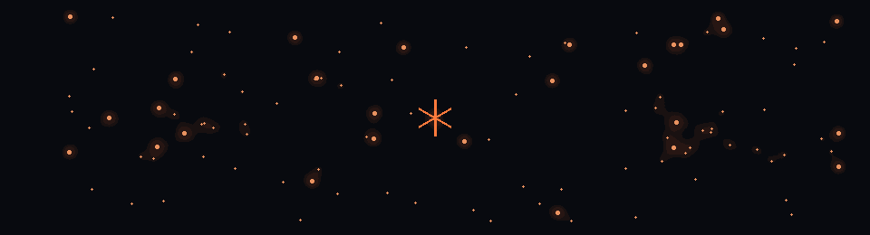
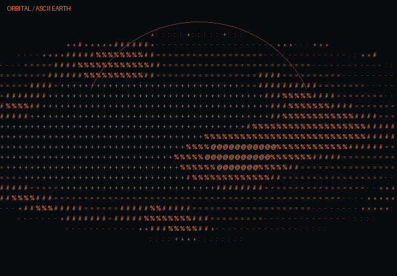

# SHOURYA PHULPAGAR

### Developer • Systems & Software Engineering • Aerospace

*Curious about what happens beneath the interface — and what becomes possible beyond it.*

---

### `01 / PROFILE`

I'm a developer exploring the intersection of software engineering, systems programming and aerospace technology.

- Writing code in **Java, Python, C and C++**
- Currently learning **Rust**
- Exploring embedded systems, cybersecurity and aerospace
- Interested in how software, hardware and complex systems fit together

 

### `02 / TECHNOLOGY`

**Languages**

**Tools & platforms**

Rust is currently a learning focus. Skill icons represent technologies I work with or explore, not equal proficiency.

### `03 / CURRENT TRAJECTORY`

| Domain | Exploring |
|:--|:--|
| Systems | Rust, memory safety, performance |
| Software | Architecture, algorithms, application development |
| Security | Cybersecurity and secure engineering |
| Aerospace | Satellites, embedded systems, electronics |
| Computing | AI systems and local model experimentation |

### `04 / SELECTED BUILDS`

Projects and experiments across software and engineering:

- **Chess-Onix** — browser-based chess analysis and Stockfish/WASM experimentation.
- **Satellite systems** — CubeSat concepts, sensor integration and embedded electronics.
- **Cybersecurity experiments** — learning through practical security-focused projects.
- **Web applications** — interfaces, APIs and full-stack experiments.

> Project descriptions will evolve as repositories become public. Visit the repositories for current work.

### `05 / GITHUB TELEMETRY`

### `06 / NEXT MILESTONES`

- [ ] Build confidence with Rust and ownership.
- [ ] Publish more systems-level projects.
- [ ] Explore secure software and embedded development.
- [ ] Turn aerospace concepts into documented engineering builds.

---

### BLAZING BEYOND BOUNDARIES.

Designed with curiosity. Built with intent.

 

